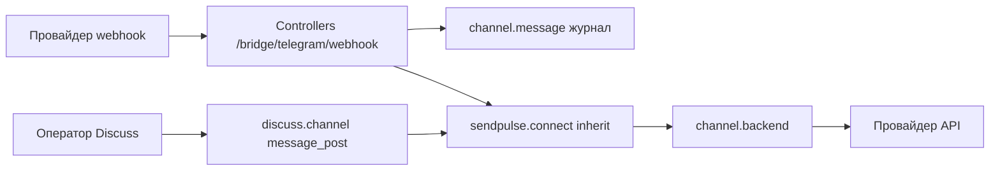
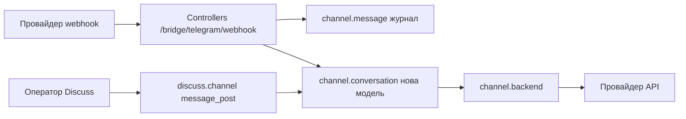

# План: повний рефакторинг `fayna_channel_bridge` до автономного модуля

## Контекст і мета

`fayna_channel_bridge` (17.0.1.0.0) — правильний модуль для власного прямого транспорту
чат-каналів Odoo (Telegram, Instagram, Facebook/Messenger, Viber, WhatsApp, LiveChat, TikTok).
Зараз він **спадкує `sendpulse.connect`** і несе багато SendPulse-посилань.

**Мета:** зробити модуль повністю автономним — окрема модель розмов, без спадкування
`sendpulse.connect`, без `sendpulse_contact_id`, без жодної згадки SendPulse.

**Критичне обмеження (безпека):** `channel.backend` зберігає чутливі дані — номери чатів,
ID, токени доступу, webhook-секрети. **Жодне значення токенів/секретів не виводиться в чат.**
Аудит безпеки робиться через скрипт на проді, який друкує лише статус (наявність, довжина,
маскування), а не самі значення.

**Критичне обмеження (поведінка):** вчора на цьому модулі тестували отримання та відправку —
модуль працює. Рефакторинг має **зберегти робочу поведінку** (webhook receive + send через
`channel.backend.send_message`).

## Поточна архітектура (SendPulse-зв'язана)

- `models/sendpulse_connect.py` — `_inherit = 'sendpulse.connect'`, поле `transport`,
  override `_send_single_message`, `_get_channel_backend`, `_send_via_own`,
  `_get_provider_user_id`, `cron_archive_old_conversations`. Використовує
  `sendpulse_contact_id` (формат `own:{service}:{bot_id}:{user_id}`).
- `models/mail_channel.py` — `_inherit = 'discuss.channel'`, override `message_post`
  для маршрутизації вихідних через `connect._send_single_message` при `transport='own'`.
  Використовує `sendpulse_connect_id`, `sendpulse.message`, `partner.sendpulse.message`.
- `models/channel_message.py` — `channel.message` журнал (вже автономний).
- `models/channel_backend.py` — `channel.backend` (807 рядків). `bot_token`,
  `webhook_secret`, `credentials` (JSON), `bot_id`, `service`, `provider`
  (direct|sendpulse), `transport_priority` (own|sendpulse|auto). Читає
  `sendpulse.facebook.page` та `odoo_chatwoot_connector.fb_page_access_token`.
- `controllers/` — webhook receive path.
- `__manifest__.py` — depends `odoo_chatwoot_connector`, опис згадує SendPulse.

## Цільова архітектура (автономна)

## Кроки рефакторингу

### 1. Нова модель розмов `channel.conversation`

Замість `_inherit = 'sendpulse.connect'` створюємо окрему модель `channel.conversation`
(файл `models/channel_conversation.py`):

- `_name = 'channel.conversation'`, `_description = 'Channel Bridge Conversation'`
- Поля (нейтральні, без SendPulse):
  - `active` (нативна архівація Odoo)
  - `service` (telegram/instagram/facebook/messenger/viber/whatsapp/tiktok/livechat)
  - `backend_id` m2o → `channel.backend`
  - `channel_id` m2o → `discuss.channel`
  - `partner_id` m2o → `res.partner`
  - `provider_user_id` Char — замість `sendpulse_contact_id` (нейтральний ID користувача провайдера)
  - `provider_bot_id` Char — для вибору backend при кількох ботах одного каналу
  - `last_message_date` Datetime
  - `stage` Selection (new_message / in_progress / done / closed)
  - `transport` Selection (own / auto) — прибрати `sendpulse` з варіантів
- Методи (перенести з `sendpulse_connect.py`):
  - `_get_channel_backend()` — за `service` + `provider_bot_id`
  - `_send_single_message()` / `_send_via_own()` — без `super()` до SendPulse
  - `_get_provider_user_id()` — читає `provider_user_id` напряму
  - `cron_archive_old_conversations()` — перенести, змінити модель у cron XML
  - `_create_discuss_channel()` — створення `discuss.channel` (аналог з бази)

### 2. `channel.backend` — прибрати SendPulse

- `PROVIDER_SELECTION`: прибрати `('sendpulse', 'SendPulse')` — лишити `direct`
- `TRANSPORT_PRIORITY_SELECTION`: прибрати `('sendpulse', 'SendPulse')` — лишити `own`/`auto`
- `_get_meta_token`: прибрати читання з `sendpulse.facebook.page` та
  `odoo_chatwoot_connector.fb_page_access_token` — читати з власних `credentials`
- Перевірити всі методи, що звертаються до `sendpulse.*` моделей

### 3. `mail_channel.py` — на нову модель

- `_inherit = 'discuss.channel'` лишається
- Замість `sendpulse_connect_id` → `channel_conversation_id` (або через `channel_id` зворотний зв'язок)
- Замість `sendpulse.message` / `partner.sendpulse.message` → `channel.message` журнал
- `message_post` override: маршрутизація через `conversation._send_single_message`

### 4. Controllers (webhook receive)

- Оновити створення/пошук розмови: замість `sendpulse.connect` → `channel.conversation`
- Формат `provider_user_id` замість `sendpulse_contact_id`
- Зберегти ідемпотентність через `channel.message` (вже є)

### 5. Views, security, cron XML, manifest

- `views/channel_backend_views.xml` — прибрати SendPulse-поля/опції
- `security/security.xml`, `security/ir.model.access.csv` — додати ACL для `channel.conversation`
- `data/channel_backend_cron.xml` — змінити `model_id` з
  `odoo_chatwoot_connector.model_sendpulse_connect` на нову модель
- `__manifest__.py` — оновити опис (прибрати "резерв до SendPulse"), додати нові файли

### 6. Тести

- Оновити `tests/test_archive_feature.py`: `_create_connect` → створює `channel.conversation`
  з `provider_user_id` замість `sendpulse_contact_id`
- Додати тести receive/send на нову модель (відтворити вчорашнє тестування)
- Прогнати docker TransactionCase — всі тести зелені

### 7. Міграція даних (прод, 1069 записів)

- Скрипт-міграція: `sendpulse.connect` (transport='own') → `channel.conversation`
  - `service` → `service`
  - `sendpulse_contact_id` (формат `own:...`) → розпарсити в `provider_user_id` + `provider_bot_id`
  - `channel_id` → `channel_id`
  - `partner_id` → `partner_id`
  - `last_message_date` → `last_message_date`
  - `stage` → `stage`
- Історія повідомлень: `sendpulse.message` (для own-розмов) → `channel.message`
- **Нічого не видаляти** — лише копіювати в нову модель, старі записи лишити
  (або заархівувати після верифікації)

### 8. Аудит безпеки токенів (БЕЗ виводу в чат)

- Скрипт на проді через `docker exec`:
  - Перевірити наявність `bot_token`, `webhook_secret`, `credentials` у `channel.backend`
  - Перевірити, що вони зберігаються зашифровано (не plaintext)
  - Вивести лише: кількість записів, чи є токен, довжину, маскування (`tok***`), чи зашифровано
  - **Не друкувати самі значення**
- Перевірити, що токени не закомічені в git-історію (git log / grep)
- Ротація: якщо знайдено plaintext або скомпрометовані — згенерувати нові

## Порядок виконання (флоу local → GitHub → staging → prod)

1. Рефакторинг локально + тести (docker TransactionCase зелені)
2. `git push origin main` → GitHub (`fayna-digital/fayna-sendpulse-odoo`)
3. Деплой на staging (git pull + `-u fayna_channel_bridge`)
4. Верифікація receive/send на staging
5. Міграція даних на staging → верифікація
6. Деплой на prod (git pull + `-u fayna_channel_bridge --no-http`)
7. Міграція даних на prod → верифікація
8. Видалити `omnichannel_bridge` з prod
9. Відкотити архівну фічу з `omnichannel_bridge` (репо VladSh77)
10. Фінальна перевірка: тільки `fayna_channel_bridge`

## Ризики

- **Втрата історії** — міграція має бути копіювальною, не руйнівною
- **Зміна поведінки** — вчорашнє тестування receive/send має бути відтворене тестами
- **Безпека** — токени не мають потрапити в чат/git
- **Залежність від `odoo_chatwoot_connector`** — модуль досі залежить від нього;
  повна автономність може вимагати від'єднання (окреме рішення)
