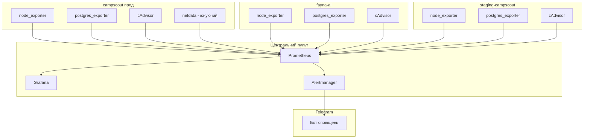

# P8 — Моніторинг та алерти (всі сервери)

> Дата: 2026-08-31
> Статус: ПЛАН (очікує затвердження перед змінами)
> Правило: **#PROD** — зміни на проді лише через затверджений план, з бекапом і відкатом.

---

## 1. Поточний стан (аудит)

| Сервер | IP | Ресурси | Моніторинг | Диск |
|--------|-----|---------|-----------|------|
| campscout (прод) | 91.98.122.195 | 4 CPU / 7.6GB RAM / 150GB | netdata-контейнер (лише метрики, БЕЗ алертів) | 76% |
| fayna-ai | 77.42.20.195 | 4 CPU / 15GB RAM / 150GB | НЕМАЄ | 57% |
| staging-campscout | 178.104.186.74 | 2 CPU / 3.7GB RAM / 75GB | НЕМАЄ | 36% |

**Ключові висновки:**
- netdata на проді працює як Docker-контейнер (`netdata/netdata:v2.9.0`, healthy), але **не має жодних алертів** — ні Telegram, ні порогів на диск/load/swap.
- fayna-ai і staging — **без моніторингу взагалі**.
- Telegram-бот для алертів **існує** (використовується в borg-скрипті бекапу), але файл `telegram.env` з токеном на проді не знайдено — треба знайти/підтвердити розташування токена.

---

## 2. Ціль (згідно стандарту Production Readiness §5)

> **Моніторинг:** Налаштовано стек Prometheus + Grafana. Відстежується споживання CPU, RAM, IOPS диска та метрики PostgreSQL (через postgres_exporter).

**Критерії готовності (Definition of Done):**
- [ ] Prometheus збирає метрики з усіх 3 серверів (CPU, RAM, диск, IOPS, мережа)
- [ ] postgres_exporter збирає метрики PostgreSQL на кожному сервері з Odoo
- [ ] cAdvisor збирає метрики Docker-контейнерів
- [ ] Grafana показує дашборди по кожному серверу
- [ ] Alertmanager шле алерти в Telegram при: диск >80%, load високий, swap використано, контейнер down, бекап не пройшов (LAST_OK застарілий)
- [ ] Алерти на бекап (S5/F5): перевірка LAST_OK на Storage Box

---

## 3. Архітектура

**Рішення щодо розміщення центрального пульта:**
- **Рекомендація:** центральний пульт (Prometheus + Grafana + Alertmanager) на **fayna-ai** (15GB RAM, диск 57% — більше запасу, ніж на проді де 76%).
- Альтернатива: на проді campscout (головний сервер, але диск 76% — ризик).

---

## 4. Компоненти та ресурси

### 4.1 Експортери (на кожному з 3 серверів)
| Компонент | Образ | Призначення | Ресурси |
|-----------|-------|-------------|---------|
| node_exporter | prom/node-exporter:v1.8.2 | CPU, RAM, диск, IOPS, мережа хоста | ~50MB RAM |
| postgres_exporter | prometheuscommunity/postgres-exporter:v0.15.0 | метрики PostgreSQL | ~50MB RAM |
| cAdvisor | gcr.io/cadvisor/cadvisor:v0.49.1 | метрики Docker-контейнерів | ~100MB RAM |

### 4.2 Центральний пульт (на fayna-ai)
| Компонент | Образ | Призначення | Ресурси |
|-----------|-------|-------------|---------|
| Prometheus | prom/prometheus:v2.53.0 | збір і зберігання метрик | ~300MB RAM |
| Grafana | grafana/grafana:11.1.0 | дашборди | ~200MB RAM |
| Alertmanager | prom/alertmanager:v0.27.0 | маршрутизація алертів | ~50MB RAM |

**Сумарно на fayna-ai:** ~700MB RAM додатково (є запас 10GB available).

---

## 5. Алерти (Alertmanager → Telegram)

### 5.1 Правила алертів (Prometheus rules)
| Алерт | Умова | Критичність |
|-------|-------|-------------|
| DiskUsageHigh | диск >80% | 🔴 критичний |
| DiskUsageWarning | диск >70% | 🟠 високий |
| LoadHigh | load > ядер × 2 | 🟠 високий |
| SwapUsageHigh | swap використано >80% | 🟠 високий |
| MemoryHigh | RAM >90% | 🟠 високий |
| ContainerDown | контейнер не працює >5 хв | 🔴 критичний |
| BackupStale | LAST_OK старше 26 год | 🔴 критичний |
| PostgresDown | postgres_exporter недоступний | 🔴 критичний |
| NodeDown | сервер недоступний >5 хв | 🔴 критичний |

### 5.2 Telegram-сповіщення
- Використати наявний Telegram-бот (той самий, що в borg-скрипті).
- Формат: `[СЕРВЕР] [КРИТИЧНІСТЬ] Алерт: опис, поточне значення`.
- Розділити канали: критичні (прод) vs інформаційні (staging/fayna).

---

## 6. Порядок виконання

### Крок 1 — Знайти Telegram-токен
- Знайти файл `telegram.env` / токен бота на серверах (borg-конфіг, n8n, env-файли).
- Якщо не знайдено — попросити користувача надати токен.

### Крок 2 — Експортери на всіх 3 серверах
- node_exporter + postgres_exporter + cAdvisor на кожному сервері.
- Додати в docker-compose кожного сервера.
- Перевірити, що експортери віддають метрики.

### Крок 3 — Центральний пульт на fayna-ai
- Prometheus + Grafana + Alertmanager.
- Налаштувати scrape-конфіги на всі 3 сервери.
- Налаштувати правила алертів.
- Налаштувати Alertmanager → Telegram.

### Крок 4 — Grafana дашборди
- Імпортувати стандартні дашборди (node-exporter-full, postgres, docker).
- Налаштувати доступ (reverse proxy + auth).

### Крок 5 — Перевірка
- Перевірити, що всі таргети scrape у Prometheus green.
- Тестовий алерт → Telegram.
- Перевірити, що алерти на бекап (LAST_OK) працюють.

---

## 7. Ризики та відкат

| Ризик | Міра | Відкат |
|-------|------|--------|
| #PROD: новий компонент на проді | Експортери — read-only, не впливають на роботу | `docker compose rm` експортерів |
| Ресурси на fayna-ai | ~700MB RAM, є запас | `docker compose down` пульта |
| Токен Telegram у відкритому вигляді | Зберігати в env-файлі з правами 600, не в репо | видалити env-файл |
| Порти експортерів відкриті | Прив'язати до 127.0.0.1 або внутрішньої мережі | змінити бінд |

---

## 8. Відкриті питання

1. **Розташування пульта:** fayna-ai (рекомендовано) чи прод campscout?
2. **Telegram-токен:** де він лежить? (шукаю на серверах)
3. **Доступ до Grafana:** через reverse proxy з auth, чи тільки через SSH-tunnel?
